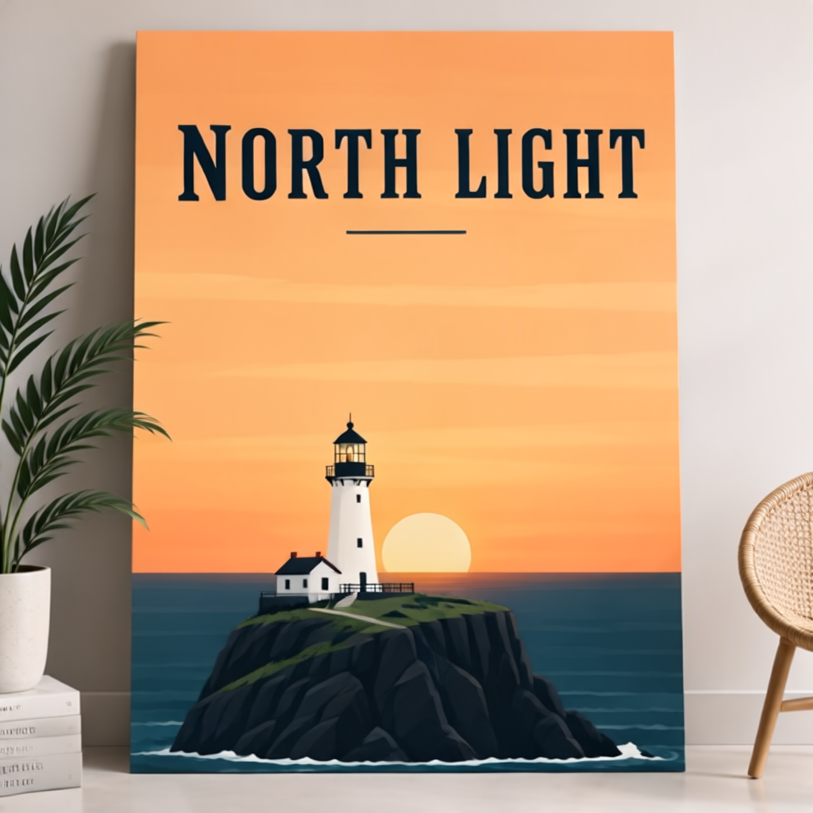

# MossForge — user guide

> MossForge runs MOSS-Image on Apple silicon (MLX): the app, `moss-mlx` and the local server. The root
> `mossforge` CLI uses a placeholder backend (no weights needed). Which settings to use and why:
> [settings-guide.md](settings-guide.md). Sharing images, the Help assistant and private feedback:
> [help-and-feedback.md](help-and-feedback.md). Training: [training.md](training.md). Editing: [editing.md](editing.md).

## Models

**Get Models** (Models screen, or Generate's first-run banner) downloads them for you from the model bundle, a
Hugging Face repo laid out as `models/` with a checksummed manifest (default
[FiditeNemini/MossForge](https://huggingface.co/FiditeNemini/MossForge); change it in Settings → Folders → Model
bundle). **Essentials** (15.5 GB: the 4-step Turbo SFT model — SFT with akhaliq's 4-step LoRA built in, int8·convrot —
plus the Qwen3.5 encoder + tokenizer and FLUX.2 VAE) is enough to generate; SFT bf16, Base bf16, the akhaliq
4-step and lodestones 8-step (`lora_latest`) LoRAs for SFT, and lodestones' Base Turbo are optional groups. Downloads need network access
(Settings → Privacy), skip files already there and verify every SHA-256. Big files come down in 32 MB pieces over
8 connections at once (several times faster than one stream on most connections), and the progress line shows
the speed and time left. **Cancel** — or a dropped connection, or quitting — keeps every finished piece: the
button then reads **Resume** and carries on from there (each piece is retried a few times before giving up).
From the terminal (also resumable — run it again):

```sh
swift run mossforge models list                          # groups, sizes, what's installed
swift run mossforge models download --groups essentials,sft [--repo owner/name] [--models dir]
```

Or put weights under `models/` yourself (ComfyUI layout):

```
models/diffusion_models/moss_image_{base,sft}_{bf16,int8_convrot}.safetensors
models/text_encoders/qwen3.5_9b_int8_convrot.safetensors
models/vae/flux2-vae.safetensors
models/text_encoders/qwen3.5-9b-tokenizer/{tokenizer.json,tokenizer_config.json}   # from Qwen/Qwen3.5-9B
models/lora/
```

Check what you have:

```sh
swift run mossforge inspect models/diffusion_models/*.safetensors models/text_encoders/* models/vae/*
```

## Recommended settings (from the MOSS-Image user guide)

| | Base / SFT | Turbo (community, 8-step DMD) |
|---|---|---|
| Steps | 50+ | 8 (fewer works) |
| CFG | 3 (3–6; higher for short prompts) | 1 (no negative) |
| Shift | 5 | — (own sampler) |
| Size | 1 / 1.5 / 2 MP, any ratio, multiples of 16 | 1 MP |
| Extras | SLG uncond-skip at block 22 | — |

Recommended negative prompt: `nsfw, worst quality, bad anatomy, watermark, jpeg artifact`.

## Prompts

Natural language (English best; Chinese supported), tag lists, or a **JSON layout**: a summary plus
items with `[y_min, x_min, y_max, x_max]` boxes in pixels **centred on the canvas**. Write visible
text literally and keep line breaks — it renders noticeably better. Try:

```sh
swift run mossforge enhance -p "a summer sale poster" --layout
```

## Generate (MLX)

```sh
cd MossForgeMLX
swift run -c release moss-mlx generate --prompt "a red fox in snow at dawn" --size 1024x1024 --seed 42 --out fox.png
```

Defaults follow the official pipeline: 50 steps, CFG 3, shift 5, block 22 skipped in the negative
branch (`--slg official`), negative prompt = the recommended tags (`--negative ""` for none).
`--slg off` disables skipping; `--slg standard:24@3` adds standard SLG on block 24 at scale 3.
Memory: the Qwen3.5 encoder (16 GB in bf16) is released after encoding; the bf16 DiT (10 GB) and VAE
stay loaded. A 1024² × 50-step image takes **~3.75 min** on an M2 Ultra (225 s, 4.4 s/step; was 311 s /
6.05 s/step before the speed pass): cond and uncond run as one packed forward with fused kernels, and the
DiT computes in fp16 (`--dit-dtype bf16` for bf16 — 5.4 s/step on M1/M2, which lack bf16 hardware;
fp16 is also the more accurate of the two). 512² × 20 steps ≈ 30 s.


### Turbo — few-step distillation LoRAs

A Turbo LoRA runs a family's DiT in a few steps at CFG 1 (no negative prompt). Two sampling routes:

| LoRA (suggested place) | Family | Steps | Route | Source (Apache-2.0) |
|---|---|---|---|---|
| `lora/lodestones/lodestones-8step-sft-latest` | SFT | 8 | flow Euler, shift 5, strength 0.7 (`lora_latest`) | lodestones/MOSS-Image-SFT-8-steps-dmd |
| `lora/lodestones/lodestones-8step-base` | Base | 8 | data-space DMD (+ its own `-dataspace`, `-time_embedding`); flow Euler also works | lodestones/MOSS-Image-Base-8-steps-dmd |
| `lora/akhaliq/akhaliq-4step-sft` | SFT | 4 | flow Euler, shift 5 — **the Turbo** (`--variant turbo`, server/MCP `"turbo"`) | akhaliq/MOSS-Image-SFT-4-steps (`moss_image_sft_4step_v2.0`) |
| `lora/akhaliq/akhaliq-2step-sft` | SFT | 2 (exactly) | flow Euler, shift 5 — draft previews | same repo (`lora_2step` = `moss_image_sft_2step_v0.1`) |

Each LoRA's family, steps, route and adapter files live in its `<file>.mfmeta.json` sidecar (edited on the app's
Models screen; without one they're guessed from the name: `sft`/`base`, `<n>step`, `<stem>-dataspace` siblings).

```sh
swift run -c release moss-mlx generate --variant turbo --prompt "…"            # SFT + akhaliq 4-step, flow
swift run -c release moss-mlx generate --variant sft --prompt "…" \
  --distill ../models/lora/lodestones/lodestones-8step-sft-latest.safetensors      # 8 steps, at its sidecar's 0.7
swift run -c release moss-mlx generate --variant base --prompt "…" \
  --distill ../models/lora/lodestones/lodestones-8step-base.safetensors            # Base, 8 steps
```

512²: 6.5 s (4-step) / ~10 s (8-step). `--model file.safetensors` runs a library DiT instead of the default;
`--steps` overrides the recipe. Any other LoRA: `--lora file.safetensors@strength`.


### LoRAs and per-block strength

`--lora path[@strength[:blocks]]`, repeatable. `blocks` is either bare ranges — `21-41` applies the LoRA only
to those DiT blocks — or weights — `0-20=0,21-41=0.5,other=0` (unlisted blocks stay 1; `*=x` sets them,
`other=x` sets embedders/modulation/text adapter/head). Kijai's SFT banding fix (the SFT LoRA's later
blocks at −0.5):

```sh
swift run -c release moss-mlx generate --variant turbo --prompt "…" \
  --lora ../models/lora/kijai/moss_image_sft_lora_blocks_21_to_49_rank_512_bf16.safetensors@-0.5
```

The Models library lists every one of these forms (chinoll's bare `lora_A` files and LoHa / LoKr were missing
before 0.2.7). Accepted formats: kohya/ComfyUI (`lora_down/up/alpha`, `.diff`, `.diff_b`), PEFT (`lora_A/B`, with or without
`.weight`; `moss-edit-lora` alphas from its `adapter_config` metadata), LyCORIS LoKr (`lokr_w1/w2`) and LoHa
(`hada_w1_a/b`, `hada_w2_a/b`); split or fused qkv. LoRAs run unmerged in F32 (distillation deltas survive bf16 base
weights); LoHa has no low-rank form, so it is merged onto a saved copy of each weight (restored when removed).

**High resolution** (4 MP and up): comfyanonymous's
[MOSS_image_MAX_ULTRA_hires_lora_test](https://huggingface.co/comfyanonymous/MOSS_image_MAX_ULTRA_hires_lora_test)
is a LoHa for **Base**. Without it, 2048² repeats small tiles of the scene; with it, the composition holds
(2026-10-27, Base + lodestones 8-step, 2048², 8 steps ≈ 2 min 20 s on this Mac). Pick 4 MP in Size and add it in
LoRAs at 1.0.

## The app

```sh
Scripts/run-app.sh          # builds and launches MossForge (models from ./models)
```

Generate → type a prompt, or switch to **Layout** and draw boxes on the canvas (drag to draw, drag to move,
corner to resize); give text boxes their literal text (new lines become line breaks) and object boxes a
caption. **Profile** sets model + Turbo + steps in one pick — *Draft — fastest* (SFT + akhaliq 2-step),
*Fast — 4 steps* (SFT + akhaliq 4-step; the default), *8 steps — lodestones* (SFT + lodestones `lora_latest`
at 0.7), *Full quality — 50 steps* (SFT, CFG 3), *Base — Turbo*, *Base — full*; profiles whose files are missing are
greyed out; **Save current as profile…** adds your own. **Model** picks a library DiT (tagged SFT or Base); **Turbo** lists only the distillation LoRAs marked
for that family (default: the first) — Off gives the full 50-step CFG sampling with shift, negative prompt and SLG.
The LoRA menu likewise offers only LoRAs marked for the model's family. Images are
saved with a JSON sidecar to `~/Pictures/MossForge` (Settings → Output) and listed in Gallery. Settings
also chooses the models folder, theme, LAN access, server port, memory (what stays loaded) and idle unload; Server starts the same HTTP
server as `moss-mlx serve`, sharing the app's GPU queue.

**Models** lists your diffusion models (`models/diffusion_models/`) and LoRAs (`models/lora/`, any subfolder). The
inspector edits the selected file's properties — a DiT's family; a LoRA's families (SFT / Base / both), whether
it's a Turbo LoRA and its recipe (steps, sampler, adapter files), default strength, slider range, source and notes — saved in a
`.mfmeta.json` sidecar beside it, and renames it, moves it to another subfolder (sidecar and adapters follow),
reveals it or moves it to the Trash. **Import…** takes a DiT, a LoRA (moved by default, or copied), an all-in-one
checkpoint (its DiT is extracted; the baked VAE/text encoder are ignored) or a diffusers `transformer/` folder (its
shards are merged; split q/k/v load as-is). A DiT saved by Forge's checkpoint merger (every tensor under
`model.diffusion_model.`, nothing else in the file) is a plain DiT: drop it in `diffusion_models/` and pick it. The shared VAE, text encoder and tokenizer are set in **Settings →
Shared components** (default: the models folder's standard places).

**Tools** (Models → a DiT): **Convert** re-encodes it (fp32 · bf16 · fp16 · int8·convrot · fp8 E4M3/E5M2 ·
int4·convrot · nvfp4; quantized formats match the Comfy-Org layout — only the 168 block linears, each with
`weight_scale` + a `comfy_quant` blob). **Fuse LoRAs** folds LoRAs into it in fp32, then encodes; a Turbo LoRA
becomes *built in* (the new model's sidecar carries its steps/route, Generate runs it at CFG 1 with no LoRA, a
data-space Turbo's `-dataspace` file is copied beside it). Fusing into an already-quantized DiT is refused — fuse
into bf16/fp32, then pick a quantized output. Measured on lodestones' 8-step: int8·convrot keeps the Turbo best,
fp16 next, **bf16 loses it**. The Fuse tool's **Preset** menu: *Distribute* (SFT + akhaliq 4-step → int8·convrot — one 5.4 GB file on the
stock Euler sampler, the one to share; credit MOSS-Image and akhaliq, both Apache-2.0), *8 steps* (lodestones
`lora_latest` at 0.7 → int8·convrot, stock Euler too), *Archive* (fp32). **Merge** does weighted sum `(1−α)A + αB` or add-difference `A + α(B − C)`.
**Extract LoRA** saves what a finetune or merge changed as a LoRA on its parent, so you can keep a few hundred MB
instead of a 10 GB file. Pick the DiT, then Tools → **Extract LoRA…**: the **Parent** is chosen for you (the
official Base or SFT file of the model's family; change it if the finetune came from something else), **Rank** is
the most each layer keeps (16–256), and **Cutoff** can lower it per layer — *Energy* keeps the smallest rank that
holds that fraction of the layer's change, *Threshold* drops singular values below that fraction of the largest.
Every Linear layer is factorised (truncated SVD); norm and bias changes are small, so they're stored whole. The LoRA
goes to `lora/extracted/` with a sidecar (the parent's family, default strength 1, notes naming source, parent and
rank); add it in Generate on the parent at strength 1. It needs ~6 GB of memory and takes ~15 s at rank 64. The
status line says how much of the difference the rank kept.

How close it gets depends on the finetune. A full finetune changes every weight a little in many directions, so a
LoRA keeps only part of it. Measured on DirtyMoss (a Base finetune) at 512², 8-step Turbo, seed 7: rank 64 (286 MB)
kept 38% of the difference and gave the same style and layout with different details (12.3 dB PSNR against
DirtyMoss; plain Base 8.8 dB); rank 256 (1.1 GB) 47%, 12.5 dB; rank 1024 (4.5 GB, CLI only) 72%, 14.1 dB. Compare a
few images before you delete the finetune.
CLI: `moss-mlx convert|fuse|merge|quant-selftest`, `moss-mlx extract-lora <dit> [--parent …] [--rank 64]
[--cutoff fixed|energy:0.9|threshold:0.02] [--precision bf16|fp16|fp32]`, `moss-mlx extract-selftest` (see
`moss-mlx` usage).

**Collections**: tag images into collections (right-click or the detail pane → Collections; add/remove, never a
toggle); the chips above the grid filter by collection. **Dataset** (above the grid) captions or exports the
visible images (all, or the active collection); the multi-select pane does the same for a selection. Batch
captioning runs the on-device captioner image after image (~15–20 s each; already-captioned images are skipped
unless *Re-caption* is on). **Export** writes `name.png` + `name.txt` (kohya / ai-toolkit), caption length of your
choice (else the prompt), optional trigger word, never overwriting. **Caption a folder of images…** writes
`name.txt` beside every image in any folder (training sets for Phase 7), passing an existing `.txt` as the
reference to correct.

**Splitters** behave the same on every screen (Generate form | preview, Gallery grid | detail, Gallery image |
details, Models list | inspector, and the grips under the prompt and the layout canvas): drag to resize, positions
are remembered, double-click a splitter to reset it.

**Gallery** selects like Finder: click, ⌘-click to toggle, ⇧-click for a range, ⌘A (or the toolbar) for all.
⌘⌫, the toolbar trash, the detail pane's trash or the right-click menu move the selection — images and their JSON
sidecars — to the Trash after a confirmation. In Gallery, select an image for **Upscale…** (ESRGAN ×2/×3/×4 in seconds, or VOSR2) and **Caption** (on-device
Qwen3.5, long/medium/short; the image's prompt is passed as the reference to correct). Upscaled copies land in the
output folder with a sidecar recording their source; captions are stored in the image's JSON sidecar under `caption`.



**Character Studio** (sidebar) builds a character-LoRA dataset in one run. Give the character a name (also the
gallery collection), a trigger word and a description of what never changes (face, hair, build, age). Each **seed
prompt** row is a framing — close-up, head & shoulders, waist up, knee up, full body, full-body action — plus a
scenario; every row is enhanced into *N* prompts (**Variations per row**, 1–8), each asking for a different camera
angle (front, three-quarter left/right, profile, low, high, candid, over the shoulder), then rendered with its own
32-bit seed. Close shots are 1:1, body shots 2:3, the action row 3:2, at the **Size** you pick (1–2 MP; full-body
faces are small, so more pixels keep them sharper). Model, Turbo, sampling and style LoRAs come from Generate.
**Write prompts** lets you read and edit them first; **Build** writes and renders in one go. The default 6 × 5 = 30
images is a pool: character LoRAs train best on about 20–25 varied images (15 at the least), so cull the ones that
look least alike — right-click → **Move to Trash** marks the row removed and it is never re-rendered — then
**Export Dataset…** writes what's left as `name.png` + `name.txt` (`trigger, prompt`), ready for Train → LoRA type
*Character*. A **reference photo** (drop it next to the description) makes the character far more consistent:
every row restages that person through an installed edit LoRA as "picture 1" — chinoll/Moss-Image-Edit is
preferred because it restages; Edit-HQ keeps the photo's framing. **Strength** (default 0.7) is that LoRA's
weight: at 1.0 edit LoRAs copy the photo's pose (a seated café photo stayed seated); 0.7 turned it into a
full-body run on a beach with the same face and hair; much lower and the likeness fades. Captions stay the row prompts; the edit instruction is saved beside them as `edit_prompt`. Without a
photo, only the description keeps the character consistent.

**Image menu**: right-click the Generate result (or a Character Studio image) for the same single-image menu —
Share, Save a Copy, Copy, Edit in Layout, Use as Edit Reference, **Upscale…**, Caption, Show in Gallery, Reveal in
Finder and **Move to Trash**.

**Share / save**: right-click the Generate result or a Gallery image → **Share…**, **Save a Copy…**, **Copy Image**
(see [help-and-feedback.md](help-and-feedback.md)). **Help** (sidebar) → **Ask** answers questions from this
documentation on device; **Feedback** (once enabled in Settings → Diagnostics & feedback) helps write a private,
redacted problem report.

## Upscaling

VOSR2 (generative) or an ESRGAN/SPAN model: `moss-mlx upscale in.png --scale 2`. See [upscaling.md](upscaling.md).

## Captioning

On-device recaptioning with Qwen3.5-9B's vision tower: `moss-mlx caption image.png`. See [captioning.md](captioning.md).

## Resident server + MCP

```sh
cd MossForgeMLX && swift run -c release moss-mlx serve --models ../models    # http://127.0.0.1:7860
curl -s -X POST http://127.0.0.1:7860/v1/moss/generate -d '{"prompt":"a red fox in snow","variant":"turbo"}' -o fox.png
```

Routes: `GET /health`, `/v1/status`, `/v1/models`, `/v1/moss/options`, `/v1/moss/loras`;
`POST /v1/images/generations` (OpenAI shape, `b64_json`), `/v1/moss/generate` (raw PNG), `/v1/moss/jobs`
(→ `202 {"id"}`; poll `GET /v1/moss/jobs/{id}`, fetch `…/image`), `/v1/moss/enhance`,
`/v1/moss/upscale` (raw PNG) and `/v1/moss/upscale/jobs` (see [upscaling](upscaling.md)), `/v1/moss/caption`
(see [captioning](captioning.md)), `/v1/moss/edit` and `/v1/moss/edit/jobs` (an edit-LoRA edit of a base64 image or
an earlier job's; see [editing](editing.md)). Body: `prompt` **or**
`layout` (JSON object), `variant` (sft | turbo | base), `size`/`width`/`height`, `n`, `steps`,
`guidance_scale`, `shift`, `seed`, `slg` (`official` | `off` | object), `loras` (`path`, `strength`,
`blocks`). Loopback only unless `--lan`; one job at a time; models unload after `--idle-unload` minutes;
`--residency auto|keepLoaded|saveMemory` is Settings → Memory (default `auto`).
MCP clients: see `mcp/README.md`.

## CLI

```sh
swift run mossforge capabilities
swift run mossforge schedule --steps 50 --shift 5    # official σ grid; --paper for the paper's
swift run mossforge generate -p "a red fox in snow" --variant sft --size 1024x1024 -o fox.png
```

## Training a LoRA

**Train** (sidebar) or `moss-mlx train`: LoRAs from a folder of captioned images, image-free **sliders**, and
experimental **edit** LoRAs from before/after pairs — with test images at every checkpoint, LoRA or LoKr adapters,
caption dropout and gradient checkpointing. Everything is in [training.md](training.md).

## Editing

**Edit in Layout** (right-click an image → Edit in Layout…) restores an image's settings and redraws only the boxes
you change; edit LoRAs take reference images. See [editing.md](editing.md).
